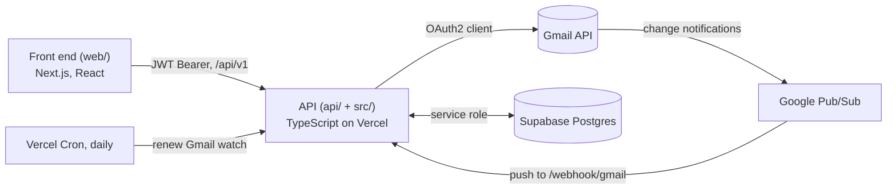

# VibeMail

**A cozy Gmail client built on its own sync engine.**

VibeMail signs you in with Google, copies your recent mail into its own Postgres database, keeps it current the moment anything changes, and serves it through a documented REST API to a front end that feels more like a village inn than an inbox.

Gmail is the teaching vehicle. The reusable pattern is **Extract, Structure, Embed**: pull data out of a provider's native shape, normalize it into your own schema, and expose it through your own contract.

## Try it

| | |
|---|---|
| **Live demo** | https://vibemail-web.vercel.app |
| **API** | https://vibemail-eta.vercel.app (health check at `/`) |

> **Heads-up:** Google sign-in only works for accounts added as testers, because the app is in Google's testing mode. Everyone else should choose **"Try the sample inbox"** on the landing page: it uses pretend mail, needs no account, and makes no API calls.

## What it does

- **Multi-user Gmail sync.** Any number of Google accounts can connect; every query is scoped to one user. A first sign-in backfills the 50 most recent inbox messages.
- **Push, not poll.** Gmail change notifications arrive through Google Pub/Sub. The webhook acknowledges immediately and syncs in the background from a stored history watermark. The sync is idempotent, and it repairs itself with a full resync if Gmail's history has expired.
- **Read, send, and read-state in both directions.** List mail with cursor pagination, send and reply, mark read or unread (pushed to Gmail first, then stored locally).
- **Careful with credentials.** OAuth tokens are encrypted in the application (AES-256-GCM) before they reach the database, never in SQL. Sessions are short-lived JWTs. Row level security is enabled as defense in depth.
- **Honest errors.** Every error uses one envelope with a typed code. Authentication failures say whether the client can simply retry or the user must sign in again (`recoverable` true or false).
- **A front end with personality.** Three themes, a background that drifts (with direction, speed and a big-circle option), a random look per visit, HTML mail in a script-less sandbox, a compose window that respects the phone keyboard, keyboard and screen-reader support, and reduced-motion support.

## How it fits together



### Design decisions worth a look

- **Contract first.** [`CONTRACT.md`](CONTRACT.md) defines every endpoint, error case and the data model (with each field's source in the Gmail API) before the code. The server, the tests and the interface all answer to it.
- **Provider abstraction.** Gmail sits behind a provider interface (`src/types/provider.ts`), so the engine is not welded to one mail service.
- **Acknowledge first, then sync.** Pub/Sub redelivers anything not acknowledged, so the webhook replies at once and does the work with `waitUntil`. A failed sync is safe: the watermark only moves after success, so the next notification picks up what was missed.
- **Tokens as production data.** Refresh tokens are merged, never overwritten with null; a dead refresh token is reported as a fatal auth failure instead of a retry loop.
- **Built in verified units.** [`BUILD_SEQUENCE.md`](BUILD_SEQUENCE.md) lists seven units, each with one check. The schema was drafted in parallel but merged only after the server's full suite passed against a live database.

## Repository layout

| Path | What lives there |
|---|---|
| `api/` | Vercel function entry points (thin wrappers) |
| `src/` | Server logic: Gmail provider, OAuth, token encryption, sync, webhook, send, read state, HTTP handlers |
| `tests/` | Backend tests, including `tests/integration/` which runs against a live Supabase database |
| `supabase/` | SQL migrations and a row-level-security smoke test |
| `web/` | The front end: its own Next.js 16 / React 19 project, with its own tests |
| `docs/` | [`DESIGN_SPEC.md`](docs/DESIGN_SPEC.md) (front-end behaviour), [`design-system/`](docs/design-system/VIBEMAIL_COZY_DESIGN.md), a Postman collection |
| [`CONTRACT.md`](CONTRACT.md) | The API contract and data model |
| [`CLAUDE.md`](CLAUDE.md) | Working notes for AI assistants and contributors |

## API at a glance

All paths below are relative to `/api/v1` except the last three. Details, error tables and request shapes are in [`CONTRACT.md`](CONTRACT.md).

| Endpoint | Purpose |
|---|---|
| `GET /auth/google` | Start sign-in (redirects to Google) |
| `GET /auth/google/callback` | Finish sign-in, back-fill, then redirect to the front end with a JWT |
| `GET /messages` | List messages (`cursor`, `limit`, `unreadOnly`) |
| `POST /messages/send` | Send or reply |
| `PATCH /messages/:id/read` | Mark read or unread |
| `POST /webhook/gmail` | Pub/Sub push target (shared-secret token) |
| `GET /api/cron/renew-watch` | Daily renewal of every user's Gmail watch |
| `GET /` | Health check |

## Run it locally

You need Node 24, a Google Cloud project, and a Supabase project. To explore the front end alone, skip all of that: run `cd web && npm install && npm run dev`, open http://localhost:3001 and choose **Try the sample inbox**.

1. **Install.** `npm install` in the repo root, and again in `web/`.
2. **Configure.** Copy `.env.example` to `.env` and fill it in (see the table below).
3. **Create the schema.** Apply `supabase/migrations/` to your Supabase project (`npm run db:push` with the Supabase CLI linked, or paste the SQL into the Supabase SQL editor).
4. **Set up Google Cloud.**
   - Create an OAuth client with the redirect URI `http://localhost:3000/api/v1/auth/google/callback`, the scopes `gmail.modify`, `openid` and `email`, and your Google account as a test user.
   - For push sync, create a Pub/Sub topic, allow `gmail-api-push@system.gserviceaccount.com` to publish to it, and add a push subscription pointing at your API's `/webhook/gmail?token=<GOOGLE_PUBSUB_VERIFICATION_TOKEN>`. Pub/Sub cannot reach `localhost`, so locally the first sync and sending work but live updates need a tunnel or a deployed API.
5. **Start the API.** `npx vercel dev` (serves http://localhost:3000). Note: the `dev` script in `package.json` is stale; use `vercel dev`.
6. **Start the front end.** `cd web && npm run dev` (serves http://localhost:3001, which must match `FRONTEND_URL`).

### Environment variables

| Variable | Purpose |
|---|---|
| `GOOGLE_CLIENT_ID`, `GOOGLE_CLIENT_SECRET` | The Google OAuth client |
| `GOOGLE_REDIRECT_URI` | Must exactly match an authorized redirect URI in Google Cloud |
| `GOOGLE_PUBSUB_TOPIC` | `projects/<project-id>/topics/<topic>` for Gmail watch |
| `GOOGLE_PUBSUB_VERIFICATION_TOKEN` | Shared secret the push subscription sends as `?token=` |
| `SUPABASE_URL`, `SUPABASE_SERVICE_ROLE_KEY` | The database (service role; per-user scoping is enforced in code) |
| `JWT_SECRET` | Signs session tokens |
| `ENCRYPTION_KEY` | 32 bytes (64 hex characters or base64) for token encryption; the app rejects a key of the wrong length |
| `FRONTEND_URL` | The one origin allowed by CORS, and where sign-in returns to (no trailing slash) |
| `CRON_SECRET` | Bearer token for the daily Gmail-watch renewal |

Values are trimmed on load, so a stray space or tab from copy-paste cannot break sign-in. The front end needs only `NEXT_PUBLIC_API_URL` (default `http://localhost:3000`).

## Tests

```bash
npm run test:unit          # backend, no database needed
npm run test:integration   # live Supabase database (Gmail is faked, Supabase never mocked)
npm test                   # both
npx tsc --noEmit           # type check

cd web
npm test                   # front end (Vitest)
npm run typecheck
```

Over 450 automated tests across the two projects, plus the live-database integration suite.

## Deploying

Two Vercel projects:

- **API**, built from the repo root, with Git auto-deploy and a daily cron (`vercel.json`).
- **Front end**, built from `web/`. Deploy it with the CLI from inside that folder: `cd web && npx vercel deploy --prod`. Do not connect this project to Git: Vercel built the repo root instead of `web/` in this layout and published an empty site.

## Known limitations

- **Replies may not thread in Gmail.** Threading needs the original message's RFC `Message-ID`, which the API does not expose yet, so replies send the thread id and a matching subject only.
- **Starred, Archive and Trash are not available.** The messages response carries no labels, so those chips are shown disabled.
- **No attachments**, in either direction.
- **Search and conversations are built in the browser** from the mail already loaded (the contract has no thread or search endpoints).
- **Drafts are local to the browser.**
- **While the Google app is in testing mode,** only listed testers can sign in, and their refresh tokens expire after 7 days, so a weekly re-consent is expected.

## Built with

TypeScript, Node.js, the `googleapis` client, Supabase (Postgres), Next.js, React, Jest, Vitest, Vercel, and [Claude Code](https://claude.com/claude-code). Fonts: Pixelify Sans and Nunito (SIL Open Font License).
